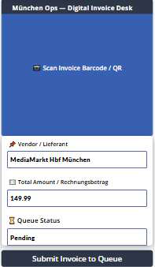
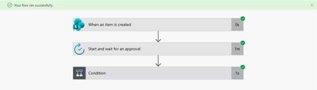
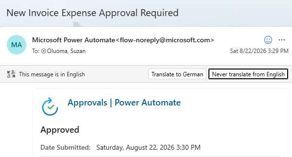
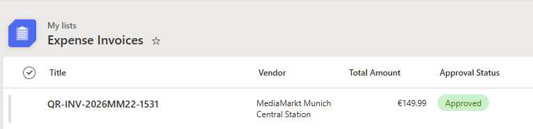

# Invoice Verification System

A low code expense approval app: employees submit an invoice from a mobile app, the record lands in a validated database, and managers approve or reject straight from their email inbox. No chasing, no retyping, no lost paperwork.

## What it does

* Mobile submission, built as a Power Apps canvas app
* Validated data layer on Microsoft Lists, no premium licenses needed
* Automatic approval workflow in Power Automate
* Approvals handled from the email inbox with Adaptive Cards
* Audit trail designed to fit DSGVO and GoBD rules for invoice data in Germany

## How it works

1. The employee photographs the invoice and attaches it in the mobile app. The vendor, amount and date are typed in by hand; there is no automatic extraction yet (see Scope and limits below)
2. The app writes the record to Microsoft Lists; validation formulas reject bad entries before they are saved
3. Power Automate triggers the moment the item is created and sends the manager an approval card
4. The manager approves or rejects from the email; the status updates by itself

## Scope and limits

This is a working approval workflow, not an OCR product. Being precise about that matters for a finance process:

* **Extraction is manual.** The invoice image is attached for the approver to look at. Nothing is read off the photo automatically. Fields are entered by the employee and checked by validation formulas on submission.
* **Single level approval.** One manager approves. Amount based escalation is not built yet.
* **Built on Microsoft Lists.** Fine for the volumes this was designed for. A real finance team on high volume would want Dataverse or the existing ERP.
* **Tested in a developer tenant,** not rolled out in a live company.

## Compliance notes

In Germany an invoice is a record, so the workflow around it becomes part of the record keeping:

* **GoBD:** every item keeps who submitted it, when, who approved or rejected it and when. Nothing is deleted on rejection, the status changes and the record stays.
* **DSGVO:** the list holds only the fields needed for approval. The approval email carries an Adaptive Card with the summary rather than the full document, so the invoice is not pushed into every inbox that happens to be in the thread.

## Demo video

Watch the walkthrough (2 minutes):

https://youtu.be/ERCdc5ukXPU

(The original recording is also kept in this repo as `demo-video.mp4`.)

## Screenshots

## Stack

Power Apps (Canvas) | Power Automate | Microsoft Lists | Adaptive Cards

## Why this stack

Runs in any Microsoft 365 tenant without premium licenses, and managers never need a new login to approve: they just answer an email.

## What I want to add next

* OCR with AI Builder, so the app reads vendor, amount and date straight from a photo and the employee only confirms what was read
* Approval levels based on the amount, and a loop that sends rejected invoices back to the submitter
* Teams notifications and a weekly summary report for the finance team

On OCR specifically: reading an amount off a photo is the easy half. The hard half is what happens when it reads the amount wrong and nobody notices. That belongs behind a human confirmation step, not in front of one.

## How to build it yourself

1. Create a Microsoft Lists list with the fields: Vendor, Total Amount, Approval Status
2. Build a canvas app from the list in Power Apps
3. Create a Power Automate flow: when an item is created, start and wait for an approval, then update the status
4. Use Adaptive Cards in the approval step so the manager can answer from the inbox

## Flow export

The Power Automate flow export lives in `power-automate/` (see `power-automate/flow-export-howto.md`).

## Author

Suzan Olamide Oluoma | Munich, Germany | olamidesuzzy@gmail.com | https://www.linkedin.com/in/oluoma-suzan
